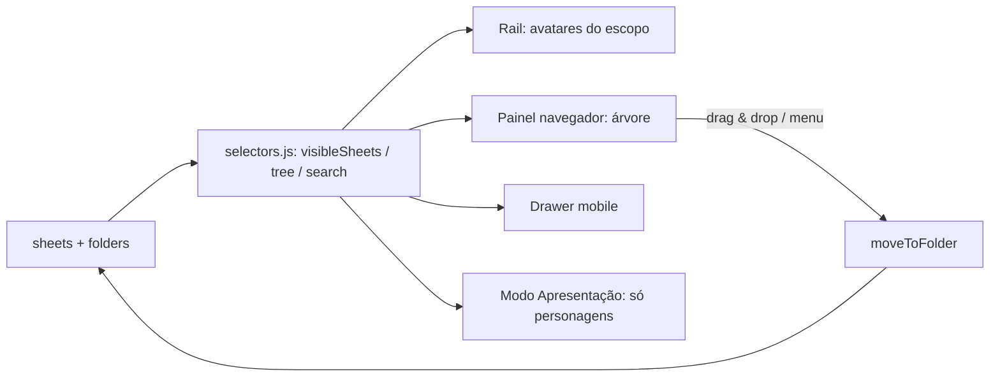

# Plano de implementação — Fichas de Ameaça + Pastas no sidebar

Projeto: `/home/ilvro/Documents/Projects/Ficha teste - Ordem II` (Vite + JS vanilla, sem framework).
Destinatário: Gemini (implementador). Idioma da UI: **pt-BR**.

---

## 0. Instruções gerais para o implementador

1. **Não regredir** fichas existentes (`ordem2` e `original`). Toda mudança de dados precisa de migração em `loadInitialSheets` / `normalizeSheet`.
2. **Não inflar o `src/app.js`** (2397 linhas, quase tudo em linhas únicas). Todo código novo de ameaça vai em módulos novos (`src/systems/threat/`), seguindo o padrão já usado por `src/systems/original/*` (módulo recebe `options` injetadas: `safeUrl`, `renderBackgroundLayer`, etc.). No `app.js` só entram os *pontos de integração* listados na §6.
3. Preservar todos os comentários existentes. Comentários novos em pt-BR, como no restante do projeto.
4. ℹ️ O `scripts/gen-default-sheets.js` embute o `sheets.json` inteiro no bundle público. Isso só importa se o dono quiser que **as criaturas próprias dele** apareçam como fichas padrão para todo visitante: nesse caso basta salvá-las no `sheets.json`. Não há restrição de conteúdo — o aviso original era só sobre copiar texto de livro, e o dono confirmou que as criaturas serão criações próprias. Fixtures de teste (as 2 imagens de referência) ficam em `dev-fixtures/`, fora do build.
5. Não reproduzir arte, sigilos ou fontes proprietárias do livro. Usar SVGs próprios (em `public/icons/threat/`) e fontes OFL auto-hospedadas em `public/fonts/` (o app é PWA/offline; sem Google Fonts por CDN).
6. Ao terminar cada fase: `npm run build` sem erros + checklist da §9.

---

## 1. Como o projeto funciona hoje (análise resumida)

| Tema | Como é feito | Onde |
|---|---|---|
| Tipos de ficha | Discriminador `sheet.systemMode`: `'ordem2'` ou `'original'` (Ordem 1). `normalizeSheet()` despacha para `normalizeOriginalSheet()`. | `app.js` L228, `original-system.js` L509 |
| Criação | Botão `+` → modal `#system-select-modal` (2 cards `data-create-system`) → `normalizeSheet({...})` → `sheets.push` → Ordem 1 abre o **wizard** (`abrirTutorial`, 6 passos) → `render()` com *glitch transition*. | `app.js` L984, L1941; `original-wizard.js` |
| Estado | `sheets[]` + `state` (ficha ativa). Rascunho de edição (`dirtySheets`, `draftBaseline`, barra “não salvo”, `discardDraft`). | `app.js` L1065-1200 |
| Persistência | Dev: `POST /api/sheets` → `sheets.json` (plugin em `vite.config.js`); fallback IndexedDB → localStorage → `DEFAULT_SHEETS`. | `app.js` L282-321, L1147 |
| Visualizações | 2 modos por ficha: **Tradicional** (dossiê) e **Cinematográfico** (token recortado com contorno SVG, linhas de moldura, HUD de recursos), + **Modo Apresentação** (percorre `sheets[]`) e exportar **PNG HD**. | `render()` L965; `original-views.js` |
| Sidebar esquerdo | `<aside class="nav-rail compact-rail">` com `.sheet-switcher`: lista **plana** de avatares (drag-reorder por `draggedSheetId`, menu de contexto mover/clonar/deletar). No mobile, `renderSheetDrawer()` lista plana. | `app.js` L967, L814, L1259, L1422 |
| Estética | Tema escuro `erpg-dark`, vermelho `#e0150d`, títulos “rasgados” (`tornTitle`, 32 usos de `clip-path`), Hanken Grotesk + Georgia, textura/fundo configurável (imagem/vídeo, blur, zoom), modo edição âmbar, atmosfera crítica (vinhetas/tentáculos/batimento por PV/PD baixos), 3D dice (`three` + `cannon-es`), `rich()` troca `+O` por ícone de d20, cores por elemento (`ELEMENT_COLORS`). | `styles.css`, `original-compendium.js` L22 |
| Rolagens | `parseRollExpression`, `roll()`, modo `highest` para múltiplos d20, log de rolagens (`rollLog`). | `app.js` L1510-1572 |
| Acessibilidade | Existente mas **parcial**: 8 `aria-label`, 6 `:focus-visible`, 5 `prefers-reduced-motion`, modais com `aria-modal`. | — |

**Conclusão:** a ficha de ameaça deve ser um **terceiro `systemMode` (`'threat'`)**, com módulo próprio, reutilizando: dados 3D/log, `rich()`, `ELEMENT_COLORS`, `CONDICOES`, tema/atmosfera, persistência, edição com rascunho, exportação JSON/PNG. E o sidebar precisa deixar de ser lista plana (§5).

---

## 2. Regras de ficha de ameaça (Ordem Paranormal RPG)

> **Fonte e confiabilidade.** A estrutura abaixo vem principalmente das **2 imagens de referência** (Dama de Sangue VD 60 e Amigo Imaginário VD 360) — essas são a verdade para o *layout*. Pesquisas web trouxeram só resumos genéricos de fóruns/Scribd; **não** usei tabelas oficiais de VD→estatísticas (não foram verificáveis). Portanto: o app **não impõe** valores por VD; só oferece cálculos que as imagens confirmam e deixa todo o resto editável.

### 2.1 Anatomia da ficha (confirmada pelas imagens)

| Bloco | Conteúdo | Observações |
|---|---|---|
| Cabeçalho | Sigilo + **Nome** + subtítulo (ex.: “SANGUE”) + **VD** grande (estilo pincel) | Banner colorido pelo elemento |
| Linha de tags | **Elementos** (Medo/Morte/Sangue/Energia/Conhecimento) · **Tipo** (Criatura) · **Tamanho** (Grande, Enorme…) | Um elemento fica destacado (caixa preenchida) |
| **Presença Perturbadora** | `DT 20 · 3d6 mental · NEX 35%+ é imune` | Só paranormais |
| **Sentidos** | Percepção `Nd20+X`, Iniciativa `Nd20+X`, texto livre (“Percepção às cegas”, alcance extremo) | |
| **Defesa** | Defesa (nº) + **Fortitude / Reflexos / Vontade** `Nd20+X` | |
| **Pontos de Vida** | PV total \| **machucado** (= metade: 105 → 52, 1000 → 500) | Imunidades, Resistências (tipo + valor), Vulnerabilidades |
| **Atributos** | AGI FOR INT PRE VIG em hexágonos | |
| **Deslocamento** | `12m \| 8□` (metros \| quadrados; 1 quadrado = 1,5 m) + extras (escalada 15m \| 10□) | |
| **Perícias** | `Furtividade 5d20+28` com variante condicional (“+48 se estiver em um quadro”) | Opcional |
| Seções livres | Título + texto (ex.: **Consumir**, **Quadros**) | Coluna esquerda |
| **Enigma de Medo** | Caixa estilizada (papel envelhecido, inclinada) com o enigma | Só paranormais |
| **Ações** | Agrupadas por tipo: **Padrão ◆**, **Movimento ❖**, **Reação ✦** (+ completa/livre). Ataques: nome, alcance (`Corpo a corpo x2`, `Distância ◇ MÉDIO`), **TESTE** `Nd20+X`, **DANO** `4d10+10 corte` | |
| **Habilidades** (coluna direita) | `MOVIMENTO ❖ ARREMESSAR (Flor Rosa)` + texto; trechos em *itálico* para fraquezas; **DT/CD** embutidas no texto | |
| Estados alterados | Ex.: **Frenesi de Sangue** (“ao ficar machucado…”) com lista de mudanças de atributos/ações | Gatilho `machucado` |

Notação de dados: `3⬡+10` = **3d20 + 10** (maior resultado). O projeto já tem o modo de rolagem `highest` e o `rich()` com ícone de d20 — reutilizar.

### 2.2 Duas categorias (o usuário pediu ambas)

| | Paranormal | Mundana (“realidade”) |
|---|---|---|
| Elementos | 1+ | oculto |
| Presença Perturbadora / Enigma de Medo | sim | **ocultos** (podem ser ligados manualmente) |
| Tipo | Criatura, Espírito… (lista editável) | Humano, Animal, Veículo/Construção… |
| Banner / tema | cor do **elemento principal** escolhido pelo usuário na criação | **branco** (tema padrão; sem elemento) |
| Seções padrão | Presença, Sentidos, Defesa, PV, Atributos, Deslocamento, Ações | idem, sem Presença |

Mesmo modelo de dados, só muda `categoria` e a visibilidade de blocos.

---

## 3. Modelo de dados

```js
// sheet.systemMode = 'threat'
{
  id, name, systemMode: 'threat', folderId, favorite: false, createdAt, updatedAt,
  categoria: 'paranormal' | 'mundana',
  subtitulo: '',                         // ex.: "SANGUE" abaixo do nome
  vd: 60,
  elementos: ['medo','morte'],           // ids de ELEMENT_COLORS (minúsculo)
  elementoDestaque: 'sangue' | null,     // define banner e chip preenchido
  tipo: 'criatura', tamanho: 'enorme',
  sigiloId: 'padrao-1' | null,           // SVG do ícone do cabeçalho

  presenca: { ativa: true, dt: 20, dano: '3d6', tipoDano: 'mental', imuneNex: 35, texto: '' },
  sentidos: { percepcao: {dados:2,bonus:10}, iniciativa: {dados:2,bonus:0}, extra: 'Percepção às cegas' },
  defesa: 20,
  salvaguardas: { fortitude:{dados:2,bonus:10}, reflexos:{dados:2,bonus:5}, vontade:{dados:2,bonus:0} },

  pv: 105, pvMax: 105, pvTemp: 0,
  machucadoOverride: null,               // null => floor(pvMax/2)
  imunidades: ['Morte'],
  resistencias: [{tipo:'Balístico',valor:10},{tipo:'Impacto',valor:10},{tipo:'Perfuração',valor:10},{tipo:'Sangue',valor:20}],
  vulnerabilidades: ['Morte'],

  atributos: {agi:2,for:3,int:1,pre:2,vig:2},
  deslocamento: { metros: 12, extras:[{tipo:'Escalada', metros:15}] },   // quadrados = metros/1.5 (calculado)
  pericias: [{ id, nome, dados, bonus, condicional:{texto:'se estiver em um quadro', bonus:48} }],

  secoes: [{ id, titulo:'Consumir', corpo:'…', estilo:'normal' | 'enigma' }],

  acoes: [{
    id, tipoAcao: 'padrao'|'movimento'|'completa'|'reacao'|'livre'|'passiva',
    nome:'Agredir', gatilho:'', custo:'', usos:null,            // usos: {atual,max} opcional
    ataques:[{ id, nome:'Tentáculo', alcance:'corpo'|'curto'|'medio'|'longo'|'extremo', multiplicador:2,
               teste:{dados:3,bonus:10}, dano:'2d6+5', tipoDano:'impacto', critico:'' }],
    texto:'…',                                                 // rich text (itálico, condições, dados inline)
    coluna:'esquerda'|'direita',
    ativaQuando: null | 'machucado',                           // destaca/“ATIVO” automático (Frenesi)
    fase: null | 'machucado'                                   // alternativa para estados alterados
  }],

  // Visual (paralelo às fichas de personagem)
  viewMode: 'livro' | 'cinematic',
  tokenImage, backgroundImage, backgroundBlur, backgroundZoom,
  cinematicTokenX/Y/Scale, cinematicOutline*,                   // reaproveitar normalização existente
  themeColor: '', diceColor: '',

  // Mesa
  condicoesAtivas: [], notasMestre: '',                         // notasMestre nunca aparece no PNG/apresentação
  tipografia: { escala: 100, alto_contraste: false }            // preferência local da ficha (override do global)
}
```

Helpers puros (em `threat-system.js`, **testáveis**): `calcMachucado(sheet)`, `calcQuadrados(m)`, `estaMachucada(sheet)`, `formatPool({dados,bonus})` → `"3d20+10"`, `parsePool(str)`, `normalizeThreatSheet(raw)`, `ameacaParaTextoLivro(sheet)` (exportar texto).

---

## 4. Ficha de ameaça — UI, estética e polimento

### 4.1 Modo **Livro** (padrão) — fiel às imagens

```
┌───────────────────────────────┬───────────────────────────────┐
│ ▓ [sigilo] NOME        (VD 60)│ MOVIMENTO ❖ ARREMESSAR (…)    │
│   SUBTÍTULO                   │   texto…                      │
│ MEDO · [MORTE] · CRIATURA · … │ MOVIMENTO ❖ CHUVA DE ÁCIDO    │
│ ▌PRESENÇA PERTURBADORA        │   texto…                      │
│  DT 20 · 3d6 mental · NEX 35+ │ PADRÃO ◆ MIASMA FÉTIDO        │
│ ▌SENTIDOS  ▌DEFESA 20 …       │   …                           │
│ ▌PONTOS DE VIDA 105 | 52      │                               │
│ ▌ATRIBUTOS ⬡⬡⬡⬡⬡              │                               │
│ ▌DESLOCAMENTO 12m | 8□        │                               │
│ ▌CONSUMIR  texto…             │                               │
│ ▌AÇÕES  PADRÃO ◆ AGREDIR      │                               │
│ ╱ENIGMA DE MEDO╱ (papel)      │                               │
└───────────────────────────────┴───────────────────────────────┘
```

- **Layout**: duas colunas (CSS multi-column ou grid) em desktop; 1 coluna no mobile (ordem: cabeçalho → PV → ações → resto). Página com proporção de livro, centralizada, fundo = textura escura + ilustração da criatura em baixo-direita com *mask-image* (fade) — igual às imagens.
- **Cabeçalho**: banner com `clip-path` rasgado, cor do elemento destacado (`ELEMENT_COLORS`), sigilo SVG, nome em fonte condensada caixa-alta, **VD** em tag branca inclinada com tipografia “pincel” (fonte display OFL + `filter` leve de aspereza). Contagem animada ao carregar (respeita `prefers-reduced-motion`).
- **Títulos de seção**: faixa preta com texto branco caixa-alta e sublinhado branco (reaproveitar o estilo de `.torn`/`tornTitle`).
- **Atributos**: hexágonos SVG (mesmo estilo dos facetados de `public/assets/original/attributes.png` / `dice-icon.js`), clique = rola `Nd20` do atributo.
- **Testes e dano** como **chips clicáveis** (`TESTE 3d20+10`, `DANO 2d6+5 impacto`) → 3D dice + log. Texto de habilidades: detectar `NdX(+Y)` e “DT N” e transformar em chips clicáveis inline; palavras de condição (confuso, caído, agarrado…) viram *tooltip/popover* com a regra vinda de `CONDICOES`.
- **Enigma de Medo / seções estilo `enigma`**: caixa de “papel envelhecido” inclinada (-2°), borda irregular, fonte serifada itálica; no mobile fica sem inclinação.
- **Ícones de ação**: ◆ padrão, ❖ movimento, ✦ reação, ◇ distância etc. como SVGs inline (nada de depender de glifos Unicode).
- **Fraquezas em itálico** via formatação rica já existente (`applyTextFormat`/`formatCardText`).

### 4.2 Modo **Cinematográfico**
Mesma ideia da ficha de personagem: token/ilustração da criatura recortada com contorno (`token-controlled-outline`, cor = elemento destacado), HUD com **barra de PV com marca de “Machucado”**, atributos em pentágono (reaproveitar o do Ordem 1), coluna rolável de ações. Reutilizar `bindCinematicToken` / `syncCinematicLineMask`.

### 4.3 Efeitos e feedback (nível das fichas de jogador)
- **Entrada**: seções revelam em cascata (stagger 40 ms), glitch transition ao trocar de ficha (reaproveitar `triggerGlitchTransition`).
- **PV**: clique/arraste na barra, botões ±1/±5/±10, campo numérico, PV temporário. Ao cruzar o limite de **machucado**: flash vermelho, som (`playGlitchSound`), selo “MACHUCADO” e **ativação automática** das ações com `ativaQuando:'machucado'` (ex.: Frenesi de Sangue ganha badge “ATIVO” e brilho). Ao zerar: estado “DERROTADA” (dessaturação + riscado).
- **Presença Perturbadora — botão “REVELAR À MESA”**: dispara sobreposição dramática (reusar `playPresentationOpenSound` + vinheta da atmosfera crítica) mostrando DT, dano e imunidade por NEX, e rola o dano mental se solicitado. Útil para o mestre projetando a tela.
- **Atmosfera por elemento**: partículas/vinheta sutil na cor do elemento (Sangue pulsante, Morte névoa cinza, Energia faíscas, Conhecimento brilho âmbar, Medo vinheta branca fria), desligável nas configurações.
- **Hover/foco** em ações: brilho na borda com a cor do elemento; **cargas/usos** (`usos`) com pips clicáveis (reusar `markers` dos cards).
- **Estados**: condições ativas como chips removíveis (reusar `condicoesAtivas`), rastreador opcional de iniciativa (campo “INIC.” + botão rolar).

### 4.4 Edição (obrigatoriamente “tão boa” quanto personagem)
- Mesmo botão flutuante de edição e **tema âmbar**, mesmo rascunho (`dirtySheets`, barra “não salvo”, descartar).
- **Edição direta na própria página** (WYSIWYG): campos aparecem como `input`/`contenteditable` nos mesmos lugares do layout do livro; não um formulário separado.
- **Editor de Ação/Habilidade** (modal no padrão do `#card-editor`): tipo de ação, nome, gatilho, custo, usos, lista de ataques (adicionar/duplicar/reordenar), texto rico, coluna, `ativaQuando`. Ações reordenáveis por arrastar/controles, duplicáveis, recolhíveis (como cards).
- **Campos calculados com cadeado**: Machucado, quadrados e (opcional) média de DT mostram valor auto + ícone de cadeado para sobrescrever.
- **Validação leve (avisos, nunca bloqueios)**: “Machucado difere de PV/2”, “Ação sem texto”, “Presença sem DT”.
- **Colar texto do livro** (opcional, Fase 5): parser que reconhece linhas `TESTE 3d20+10 | DANO 2d6+5 impacto` e cabeçalhos de seção e pré-preenche.
- **Duplicar ameaça** (clone com novos ids), **exportar/importar JSON**, **PNG HD** (reaproveitar `exportCinematicImage`; omitir `notasMestre`), **versão impressa** (ver 4.5).

### 4.5 Acessibilidade (meta: superar as fichas atuais)
- **Semântica**: `<article>` por ficha, `<h1>` nome, `<h2>` por seção, `<dl>` para pares rótulo/valor (Defesa, PV, Deslocamento), `<ul>` para ações; hexágonos de atributo com `role="img"` + `aria-label="Força 3"`.
- **Dados por texto**: todo ícone de d20 tem equivalente textual (`aria-label="3d20 mais 10"`); `rich()` ganha atributo acessível.
- **Teclado**: tudo operável (Tab/Enter/Espaço); chips de rolagem são `<button>`; atalhos: `R` rola ação focada, `[`/`]` ajustam PV, `E` alterna edição (documentar em ajuda “?”).
- **Anúncios**: região `aria-live="polite"` para PV (“PV 52 de 105 — machucada”), resultado de rolagens, ativação de estados.
- **Contraste AA**: cores de elemento servem como *preenchimento*; textos usam variantes mais claras (ex.: `Morte #70707a` sobre fundo escuro dá ~4:1 → usar `#a9a9b4` para texto). Verificar com checagem automática.
- **Nunca só cor**: elemento = cor + ícone + texto; machucado = cor + selo + texto.
- **Preferências** (em Configurações, persistidas em `appSettings`): escala de fonte (A− / A+ 80–150%), **modo leitura** (sem textura/efeitos, fundo liso), alto contraste, reduzir movimento (respeitar `prefers-reduced-motion` *e* oferecer toggle), desligar áudio/atmosfera. Suporte a `forced-colors`.
- **Alvos de toque ≥ 44 px**; modais com foco preso e retorno ao gatilho; `Esc` fecha.
- **Impressão**: `@media print` em A4, 2 colunas, fundo branco, sem efeitos — equivalente ao PDF do livro (botão “Imprimir/PDF”).

---

## 5. Sidebar esquerdo com **pastas** (escalável)

### 5.1 Requisitos
- Pastas padrão **Personagens** e **Ameaças** (do sistema, não deletáveis, renomeáveis) + pastas do usuário, com **1–3 níveis** (ex.: *Campanha X → Capítulo 2*).
- Escolher **quais pastas aparecem** no sidebar.
- Continuar funcionando com **centenas** de fichas sem ficar bagunçado.

### 5.2 Modelo de dados e persistência
```js
workspace = {
  version: 2,
  folders: [{ id, name, kind: 'characters'|'threats'|'custom', parentId: null, color, icon,
              collapsed: false, order: 0, system: true|false }],
  sheets: [ …cada ficha com folderId… ]
}
```
- Fichas existentes → pasta **Personagens** (migração automática); ameaças novas → **Ameaças**.
- Ordem **manual** continua sendo a ordem do array `sheets` (compatível com drag atual); pastas têm `order` próprio.
- Preferências de UI do sidebar em `appSettings` (`APP_SETTINGS_KEY`): `sidebarVisibleFolderIds`, `sidebarScope`, `sidebarExpanded`, `sidebarSort`, `sidebarFilters`.
- **Compatibilidade de armazenamento**: manter `ordem-ii-sheets-v1`/`idbGet('sheets')` como array e **adicionar** `folders` em chave separada (`idbSet('folders')`, `ordem-ii-folders-v1`) + `POST/GET /api/folders` no plugin do `vite.config.js` (guardar em `folders.json`, adicionar ao `.gitignore`/`watch.ignored`). Se `folders` ausente → criar as 2 pastas padrão. Atualizar `exportJsonSheet/importJsonSheet` para levar `folderId` e criar a pasta de destino se faltar.

### 5.3 UI

**Rail (colapsado, ~64 px)** — mantém avatares, mas:
1. **Seletor de escopo no topo** (ícones): `Todas` · `Personagens` · `Ameaças` · pastas fixadas. Filtra os avatares exibidos (é o “escolher o que ver por folder”).
2. Avatares de ameaça com **anel na cor do elemento + selo de VD**; personagens mantêm o formato atual. `title` e `aria-label` com nome, sistema e pasta.
3. Botão **“Navegador de fichas”** (ícone pasta) → abre o painel expandido.
4. `+` **contextual**: cria na pasta/escopo atual.

**Painel expandido (~300 px, fixável)** — o “navegador”:
- Busca instantânea (nome, elemento, tipo, VD, texto) com resultado plano + breadcrumb da pasta.
- **Árvore de pastas** com contagem, cor, recolher/expandir, **olho 👁 por pasta** (multi-seleção do que aparece no rail), “Recolher tudo”.
- Seções fixas no topo: ⭐ **Favoritas** e 🕘 **Recentes** (últimas 8).
- Filtros: sistema (Ordem 2 / Ordem 1 / Ameaça), elemento, faixa de VD, categoria (paranormal/mundana), favoritas. Ordenação: manual (padrão), nome, VD, recente.
- **Arrastar e soltar**: sobre pasta = mover; entre itens = reordenar (estender a lógica de `draggedSheetId`); arrastar pasta para reordenar/aninhar.
- **Menu de contexto** ampliado: Mover para pasta…, Favoritar, Renomear, Clonar, Deletar; em pasta: Nova ficha aqui, Nova subpasta, Renomear, Cor/ícone, Esvaziar/Excluir (conteúdo vai para a pasta pai, com *toast* “Desfazer”).
- **Quick switcher `Ctrl+K`** (paleta de comandos): digita e pula para qualquer ficha/pasta — solução principal de escala.
- **Escala**: renderizar apenas pastas expandidas; **virtualização/janela** da lista quando visíveis > ~150; `content-visibility:auto` nas linhas; debounce de busca (120 ms).
- **Teclado/AT**: padrão WAI-ARIA **tree** (`role="tree"/"treeitem"`, `aria-expanded`, setas, Home/End, digitação rápida, `F2` renomear, `Del` excluir com confirmação).
- **Mobile**: `renderSheetDrawer()` passa a renderizar a mesma árvore (bottom sheet/drawer), com busca no topo.



### 5.4 Impactos que o implementador **deve** tratar
- Hoje `sheets.findIndex(...)`/`presentationIndex` assumem lista única (moveSheet, drop, apresentação). Criar `selectors` (`visibleSheets()`, `sheetsInFolder()`) e **trocar os usos**. Modo Apresentação: por padrão **só personagens** (opção “incluir ameaças”).
- `cloneSheet` mantém `folderId`; `deleteSheet` atualiza contadores; ficha ativa oculta pelo filtro continua acessível (não perde a ficha atual).
- `data-new-sheet` / modal de sistema: **3º card “AMEAÇA”** (“Ordem Paranormal RPG — Criatura/NPC”), com escolha Paranormal/Mundana no wizard.

---

## 6. Arquitetura de arquivos

**Novos**
```
src/systems/threat/threat-data.js       # enums: tamanhos, tipos de ação, alcances, tipos de dano, elementos, sigilos
src/systems/threat/threat-system.js     # normalizeThreatSheet + helpers puros (cálculos, parse/format de pool)
src/systems/threat/threat-views.js      # renderThreatBook(), renderThreatCinematic(), editores
src/systems/threat/threat-wizard.js     # fluxo de criação (padrão do original-wizard.js)
src/systems/threat/threat-balance.js    # tabela da editora + predefinições + sugestões (§11)
src/systems/threat/threat-richtext.js   # chips de dado/DT/condição inline + tooltip de condições
src/workspace/folders.js                # modelo de pastas, migração, mover, CRUD
src/workspace/selectors.js              # visibleSheets, tree, busca/filtros/ordenação
src/workspace/sidebar.js                # rail + painel navegador + quick switcher + drawer (render + bind)
public/icons/threat/*.svg               # sigilos, ícones de ação, selos
public/fonts/*.woff2                    # display condensada + serifada (OFL)
src/threat.css  (importado em styles.css ou main)  # estilos da ficha de ameaça
src/sidebar.css                         # estilos do sidebar
dev-fixtures/threats/*.json             # fichas de teste (NÃO entram no build)
```

**Alterados (apenas pontos de integração)**
| Arquivo | Mudança |
|---|---|
| `app.js` `normalizeSheet` (L228) | `if(raw.systemMode==='threat') return normalizeThreatSheet(raw)` |
| `app.js` `render()` (L965) | despachar `threat` → `renderThreatBook/Cinematic`; rail passa a vir de `sidebar.js` |
| `app.js` modal (L984) + `data-create-system` (L1941) | 3º card + criação com wizard; `folderId` da pasta ativa |
| `app.js` `renderSheetDrawer`, `bindSheetInteractions`, `showSheetContextMenu`, `moveSheet`, `cloneSheet`, `deleteSheet` | migrar para `workspace/*` |
| `app.js` presentation (`openPresentationMode`, `cyclePresentation`…) | usar `visibleSheets({apenasPersonagens:true})` |
| `app.js` `loadInitialSheets`/`persistSheetsNow`/`save` | carregar/salvar `folders`; migração |
| `app.js` rolagens | `rollThreatTest(id)`, `rollThreatDamage(id)` usando `roll()` (modo `highest` para Nd20) e etiqueta “AMEAÇA” no `rollLog` |
| `app.js` export/import JSON, `exportCinematicImage` | suportar `threat`; omitir `notasMestre` |
| `vite.config.js` | endpoint `/api/folders`; ignorar `folders.json` |
| `scripts/gen-default-sheets.js` | continuar só com `sheets.json`; garantir que pastas padrão existam sem arquivo |
| `public/sw.js` | cachear novas fontes/ícones |
| `README.md` | documentar ameaças e pastas |

---

## 7. Fluxo de criação de ameaça (wizard no padrão do Ordem 1)

1. **Categoria**: Paranormal / Mundana (+ “Começar de modelo em branco”).
2. **Identidade**: nome, subtítulo, **VD**, elementos (+ destaque), tipo, tamanho, imagem/token.
3. **Estatísticas**: atributos, defesa, Fortitude/Reflexos/Vontade, PV (machucado auto), deslocamento, sentidos — com o **assistente de sugestões de balanceamento da §11** ao lado de cada campo (só sugere, nunca impõe).
4. **Defesas**: imunidades, resistências, vulnerabilidades.
5. **Presença Perturbadora** (só paranormal): DT, dano, imunidade por NEX. + **Enigma de Medo** opcional.
6. **Ações/Habilidades**: modelos rápidos (“Agredir” com ataque corpo a corpo, “Movimento”, “Reação”).
7. **Revisão** com pré-visualização ao vivo do modo Livro. Pular a qualquer momento (setting `tutorialThreat`, como `tutorialOriginal`); ao final, cria na pasta ativa (padrão **Ameaças**) com glitch transition.

---

## 8. Fases de entrega

| Fase | Entrega | Critério de aceite |
|---|---|---|
| **1. Fundação** | `workspace/folders.js`, migração (todas as fichas → Personagens), pastas padrão, persistência (IDB/localStorage/`/api/folders`), `selectors.js`, 3º `systemMode` normalizado | Abrir o app com dados antigos: nada muda visualmente, fichas intactas; export/import mantém `folderId` |
| **2. Sidebar** | Rail com escopo + olho por pasta; painel navegador (árvore, busca, favoritas, recentes, drag&drop, menu); mobile drawer; Ctrl+K | Com 300 fichas fictícias: busca < 100 ms, rolagem fluida, teclado completo |
| **3. Ficha de ameaça (modo Livro)** | Layout, header/VD, todos os blocos §2.1, rolagens, PV/machucado, edição direta, editores de ação, categorias paranormal/mundana | Reproduzir **as 2 imagens de referência** em `dev-fixtures` com fidelidade visual; todas as rolagens funcionam |
| **4. Wizard + balanceamento + cinematográfico + efeitos** | Wizard §7, **sugestões de balanceamento §11**, modo cinematográfico, atmosfera por elemento, Presença “REVELAR À MESA”, estados por machucado, PNG HD | Criar ameaça do zero em < 2 min; PNG sem notas do mestre |
| **5. Acessibilidade e extras** | Configurações de a11y, `aria-live`, print/PDF, colar texto do livro, tooltips de condição | Checklist a11y abaixo 100%; Lighthouse a11y ≥ 95 |

---

## 9. Checklist de verificação

- `npm run build` ok; `npm run dev` sem erros no console.
- Sem regressão: criar/editar fichas Ordem 2 e Ordem 1; wizard Ordem 1; modo apresentação; exportar PNG.
- Migração: `sheets.json` antigo (array puro) carrega; `folders` ausentes são criadas.
- Ameaça: 5 atributos, saves, PV/machucado (105→52, 1000→500), deslocamento (12 m→8□), ações com `x2`, `Distância ◇ MÉDIO`, habilidade com `ativaQuando:'machucado'`.
- Sidebar: mover por arrastar, por menu e por teclado; ocultar/mostrar pasta; excluir pasta (conteúdo vai ao pai + desfazer); ficha ativa sempre alcançável.
- A11y: navegação só com teclado, leitor de tela anuncia PV/rolagem, `prefers-reduced-motion`, contraste AA, zoom 200 % sem perda, impressão A4.
- Testes unitários (sugerido: `vitest` só como devDependency) para `threat-system.js`, `folders.js` (migração) e `selectors.js`.

---

## 10. Decisões já tomadas pelo dono do projeto

- Criaturas serão **criações próprias** (sem bestiário oficial pronto); fichas padrão no `sheets.json` são permitidas.
- **Modo Apresentação**: apenas personagens.
- **Elemento destacado = elemento principal** da criatura, escolhido pelo usuário na criação. Define banner, contorno e atmosfera. **Ameaças mundanas não têm elemento** → tema padrão **branco**.
- Fontes livres (OFL) auto-hospedadas: pendente de confirmação, seguir a sugestão do plano.

---

## 11. Sugestões de balanceamento (assistente tipo tutorial, **somente sugestões**)

### 11.1 Origem e filosofia
Fonte: planilha de balanceamento da editora (aba *Parâmetros de Ameaças*), usada para ameaças do Outro Lado. A própria planilha explica que as metas são calculadas contra **personagens otimizados** (“combo máximo”):
- ataque da ameaça deve acertar a Defesa **maximizada** com valor que não seja só 20;
- dano médio ≥ **metade do PV maximizado** (derrubar um personagem otimizado em 2 rodadas);
- Defesa da ameaça deve ser acertada por ataque **maximizado** com valor médio;
- Presença Perturbadora: dano mental médio ≈ 60% da Sanidade mínima do NEX.

Por isso o app oferece **3 predefinições** (o dono pediu valores um pouco menores por padrão):

| Predefinição | Quando usar | Regra aplicada sobre a tabela da editora |
|---|---|---|
| **Fiel à editora** | grupo muito otimizado | valores originais |
| **Equilibrada** (**padrão**) | maioria das mesas | PV ×0,8 (arred. a 5 se ≥ 35) · Defesa −2 (mín. 10) · bônus de ataque −5 (mín. 0) · dano médio ×0,75 · bônus de Resistência −5 só quando ≥ +10 · DT −2 (mín. 10) · Presença com ≈ 85% do dano médio |
| **Leve** | grupo novato / narrativa | mesmas regras, mas PV ×0,65 · Defesa −4 · ataque −10 (mín. 0) · dano ×0,55 · Resistência −10 (mín. 0) · DT −4 · Presença ≈ 70% |

O usuário troca a predefinição num seletor (guardado em `appSettings.balancePreset`) e pode **ajustar um deslizador “Dificuldade” (−20% … +20%)** sobre PV e dano. Dados (nº de d20) **nunca** são alterados — só bônus fixos —, pois mudar a quantidade de dados mexe demais na probabilidade.

### 11.2 Tabela base (editora, por VD) — colocar em `threat-data.js`
Formato: `[vd, pv, defesa, ataque[dados,bônus], danoMédio, resForte[d,b], resMédia[d,b], resFraca[d,b], dt, presença[nDados,faces]|null]`.
> Atenção: **não** ler o .xlsx diretamente (a coluna “Nível” vem corrompida como datas; VD 10 = nível ½). Usar exatamente os valores abaixo. Nível/ND = VD ÷ 20.

```js
export const BALANCE_BASE = [
  [10, 15, 14, [1,5], 6, [1,5], [1,0], [1,0], 13, null],
  [20, 35, 16, [2,5], 12, [2,5], [1,0], [1,0], 14, [2,6]],
  [40, 70, 19, [2,10], 17, [2,5], [1,5], [1,0], 15, [2,8]],
  [60, 105, 21, [3,10], 26, [3,10], [2,5], [2,0], 19, [3,6]],
  [80, 140, 23, [3,10], 32, [3,10], [2,5], [2,0], 20, [3,8]],
  [100, 200, 25, [3,15], 38, [3,10], [2,5], [2,0], 21, [4,6]],
  [120, 240, 28, [3,15], 62, [4,10], [3,10], [2,5], 23, [4,6]],
  [140, 280, 31, [4,15], 69, [4,10], [3,10], [2,5], 24, [4,8]],
  [160, 320, 34, [4,20], 77, [4,10], [3,10], [2,5], 25, [4,8]],
  [180, 360, 36, [4,20], 104, [4,15], [3,15], [2,10], 28, [6,6]],
  [200, 400, 38, [4,25], 113, [4,15], [3,15], [2,10], 29, [6,6]],
  [220, 550, 40, [5,25], 122, [4,15], [3,15], [2,10], 30, [7,6]],
  [240, 600, 42, [5,30], 131, [4,20], [4,15], [3,10], 31, [6,8]],
  [260, 650, 44, [5,30], 140, [4,20], [4,15], [3,10], 37, [8,6]],
  [280, 700, 46, [5,30], 150, [5,20], [4,15], [3,10], 38, [8,6]],
  [300, 750, 48, [5,35], 159, [5,25], [4,20], [3,15], 39, [7,8]],
  [320, 800, 50, [5,35], 192, [5,25], [5,20], [4,15], 40, [9,6]],
  [340, 1020, 53, [5,35], 202, [5,25], [5,20], [4,15], 41, [10,6]],
  [360, 1080, 56, [5,40], 212, [5,30], [5,25], [4,20], 42, [8,8]],
  [380, 1140, 58, [5,40], 223, [5,30], [5,25], [5,20], 43, [9,8]],
  [400, 1200, 60, [5,45], 233, [5,35], [5,30], [5,25], 44, [10,8]],
];
// Média esperada de um pool de Nd20 (maior resultado): 1D≈10 · 2D≈13 · 3D≈15 · 4D≈16 · 5D≈17
// Dica de elemento (planilha): Sangue é menos resistente a corte · Morte a balístico · Conhecimento a perfuração · Energia a impacto.
```

Resultado da predefinição **Equilibrada** (já calculado, para conferência dos testes unitários; `antes→depois`):

| VD | PV | Def | Ataque | Dano méd. | Res. forte | Res. média | Res. fraca | DT | Presença (dano) |
|---|---|---|---|---|---|---|---|---|---|
| 10 | 15→12 | 14→12 | 1D+5→1D+0 | 6→4 | 1D+5 | 1D | 1D | 13→11 | — |
| 20 | 35→30 | 16→14 | 2D+5→2D+0 | 12→9 | 2D+5 | 1D | 1D | 14→12 | 2d6→1d10 |
| 40 | 70→55 | 19→17 | 2D+10→2D+5 | 17→13 | 2D+5 | 1D+5 | 1D | 15→13 | 2d8→2d6 |
| 60 | 105→85 | 21→19 | 3D+10→3D+5 | 26→20 | 3D+10→3D+5 | 2D+5 | 2D | 19→17 | 3d6→2d8 |
| 80 | 140→110 | 23→21 | 3D+10→3D+5 | 32→24 | 3D+10→3D+5 | 2D+5 | 2D | 20→18 | 3d8→2d10 |
| 100 | 200→160 | 25→23 | 3D+15→3D+10 | 38→28 | 3D+10→3D+5 | 2D+5 | 2D | 21→19 | 4d6→2d10 |
| 120 | 240→190 | 28→26 | 3D+15→3D+10 | 62→46 | 4D+10→4D+5 | 3D+10→3D+5 | 2D+5 | 23→21 | 4d6→2d10 |
| 140 | 280→225 | 31→29 | 4D+15→4D+10 | 69→52 | 4D+10→4D+5 | 3D+10→3D+5 | 2D+5 | 24→22 | 4d8→3d10 |
| 160 | 320→255 | 34→32 | 4D+20→4D+15 | 77→58 | 4D+10→4D+5 | 3D+10→3D+5 | 2D+5 | 25→23 | 4d8→3d10 |
| 180 | 360→290 | 36→34 | 4D+20→4D+15 | 104→78 | 4D+15→4D+10 | 3D+15→3D+10 | 2D+10→2D+5 | 28→26 | 6d6→4d8 |
| 200 | 400→320 | 38→36 | 4D+25→4D+20 | 113→85 | 4D+15→4D+10 | 3D+15→3D+10 | 2D+10→2D+5 | 29→27 | 6d6→4d8 |
| 220 | 550→440 | 40→38 | 5D+25→5D+20 | 122→92 | 4D+15→4D+10 | 3D+15→3D+10 | 2D+10→2D+5 | 30→28 | 7d6→6d6 |
| 240 | 600→480 | 42→40 | 5D+30→5D+25 | 131→98 | 4D+20→4D+15 | 4D+15→4D+10 | 3D+10→3D+5 | 31→29 | 6d8→5d8 |
| 260 | 650→520 | 44→42 | 5D+30→5D+25 | 140→105 | 4D+20→4D+15 | 4D+15→4D+10 | 3D+10→3D+5 | 37→35 | 8d6→7d6 |
| 280 | 700→560 | 46→44 | 5D+30→5D+25 | 150→112 | 5D+20→5D+15 | 4D+15→4D+10 | 3D+10→3D+5 | 38→36 | 8d6→7d6 |
| 300 | 750→600 | 48→46 | 5D+35→5D+30 | 159→119 | 5D+25→5D+20 | 4D+20→4D+15 | 3D+15→3D+10 | 39→37 | 7d8→6d8 |
| 320 | 800→640 | 50→48 | 5D+35→5D+30 | 192→144 | 5D+25→5D+20 | 5D+20→5D+15 | 4D+15→4D+10 | 40→38 | 9d6→6d8 |
| 340 | 1020→815 | 53→51 | 5D+35→5D+30 | 202→152 | 5D+25→5D+20 | 5D+20→5D+15 | 4D+15→4D+10 | 41→39 | 10d6→8d6 |
| 360 | 1080→865 | 56→54 | 5D+40→5D+35 | 212→159 | 5D+30→5D+25 | 5D+25→5D+20 | 4D+20→4D+15 | 42→40 | 8d8→9d6 |
| 380 | 1140→910 | 58→56 | 5D+40→5D+35 | 223→167 | 5D+30→5D+25 | 5D+25→5D+20 | 5D+20→5D+15 | 43→41 | 9d8→10d6 |
| 400 | 1200→960 | 60→58 | 5D+45→5D+40 | 233→175 | 5D+35→5D+30 | 5D+30→5D+25 | 5D+25→5D+20 | 44→42 | 10d8→11d6 |

(Resistências onde só há um valor não mudam: a regra só reduz bônus ≥ +10. A Presença usa a combinação `NdF`, F ∈ {6,8,10}, mais próxima de 85% da média original; em VD 360–400 a conta resulta em mais dados de d6, o que é esperado — o implementador pode preferir manter o mesmo `NdF` e só garantir que a média não suba, ajustar se achar mais coerente.)

### 11.3 Funções puras (em `threat-balance.js`, com testes)
- `getBalance(vd, preset, slider)` → objeto de sugestões; para VD fora da tabela (ex.: 30, 70, 90, 450) **interpola linearmente** entre os dois VD vizinhos (extrapola até VD 400 e avisa “acima do máximo da tabela”).
- `applyPreset(row, preset)` — implementa as regras da tabela de predefinições.
- `suggestDamage(mean)` → sugere expressões que somam a média (ex.: 26 → `4d8+8`, `3d10+10`, `2d12+13`), com 3 opções ordenadas por “naturalidade” (dados maiores, bônus < dados).
- `suggestAttackDamageSplit(danoTotal, nAtaques)` — divide o dano médio entre ataques múltiplos (ex.: “Corpo a corpo x2” → cada ataque ≈ metade).
- `evaluateSheet(sheet, preset)` → lista de **avisos** (não bloqueia): cada campo vs. sugestão, com status “abaixo / dentro / acima” (faixa ±15%).

### 11.4 Como aparece na UI (modo tutorial opcional)
1. **Chip de sugestão ao lado de cada campo** no editor: `PV  [ 85 ]  💡 sug. 85` — clicar no 💡 preenche; digitar outro valor é livre. Status por cor **e ícone/texto** (▼ abaixo, ● dentro, ▲ acima) para acessibilidade.
2. **Painel “Equilíbrio” (lateral recolhível no modo edição)** com um **medidor** por stat (PV, Defesa, Ataque, Dano, Resistências, DT, Presença) comparando com a sugestão do VD atual, mais o botão **“Aplicar todas as sugestões”** (com desfazer) e **“Aplicar só os campos vazios”**.
3. **Modo guiado** (passo 3 do wizard §7): perguntas curtas — *“Qual o NEX médio do grupo?”* (converte para VD sugerido = NEX-nível × 20), *“O grupo é otimizado?”* (escolhe predefinição), *“Esta criatura é: brutamontes / ágil / mental / chefe”*. Os arquétipos redistribuem a mesma “verba” sugerida: brutamontes (+PV/dano, −Defesa/Resistências fracas), ágil (+Defesa/Reflexos, −PV), mental (+Vontade/Presença, −dano físico), chefe (+PV, +ações). **Só ajustam sugestões.**
4. **Textos de ajuda** curtos explicando o porquê (“Dano médio sugerido: o suficiente para derrubar um personagem em ~3 rodadas”).
5. **Dica de elemento** nas Resistências: ao escolher o elemento principal, sugerir a fraqueza (Sangue→corte, Morte→balístico, Conhecimento→perfuração, Energia→impacto) como *chip* “adicionar vulnerabilidade/menor resistência”. Medo não tem dica na planilha (não inventar).
6. **Desligável** (`appSettings.balanceHints`, padrão ligado) e escondido no modo Livro de leitura/Apresentação.
7. **Acessibilidade**: sugestões são `<button>` com `aria-label` (“Aplicar sugestão de PV: 85”), medidores com `role=meter` + texto equivalente, nunca só cor.

### 11.5 Itens extras opcionais
- “**Calculadora de encontro**”: soma de VD das ameaças vs. VD sugerido do grupo (nº de agentes × nível×20), com semáforo.
- Aviso quando o **dano médio total por rodada** (todas as ações padrão somadas) passa de ~½ do PV de um personagem de referência do NEX escolhido — usa a tabela “PV Personagem” (coluna da planilha: 12, 24, 34, 52, 64, 76, 103, 115, 127, 148, 161, 174, 187, 200, 213, 226, 239, 252, 265, 278, 291 para VD 10…400; Defesa de referência 20→58).

### 11.6 Testes
- `getBalance(60,'editora')` retorna a linha original; `getBalance(60,'equilibrada')` retorna PV 85, Def 19, ataque 3D+5, dano 20, DT 17.
- Interpolação: VD 50 fica entre as linhas 40 e 60 (PV 70→105 ⇒ 87,5 → arredonda 90 em “editora”).
- Nunca altera a quantidade de dados; nunca devolve bônus negativo nem Defesa < 10.
